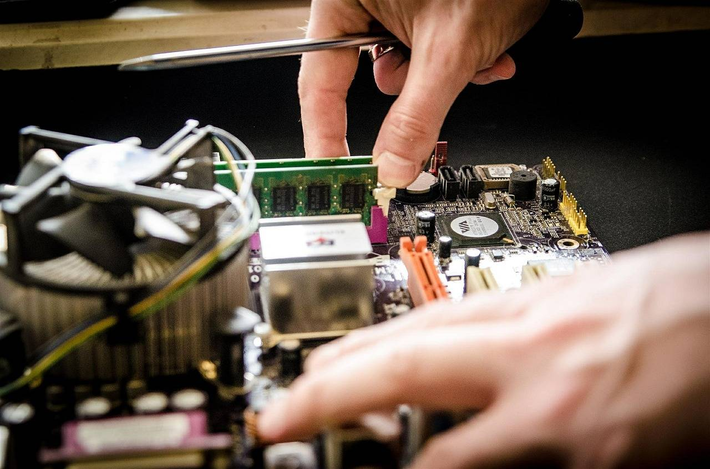

# Bearing Fault Diagnosis - Sparse Bayesian Learning (SBL) for bearing fault diagnosis, two swarm sparse learning algorithms to extract faulty pulses, the first one only using the faulty pulses.

[Bearing Fault Diagnosis]A Sparse Bayesian Learning (SBL) for bearing fault diagnosis, two swarm sparse learning algorithms to extract faulty pulses. The first one only utilizes the group sparsity of faulty pulses, while the second one exploits the additional periodic behavior of faulty pulses (Matlab code implementation).

## Images

<!-- PAYMENT_BLOCK -->

## Get this dataset

- Payment link (Stripe): [Buy now](https://buy.stripe.com/3cs8yP7sY87d0vu9AB)
- Payment QR code: 

<!-- /PAYMENT_BLOCK -->
